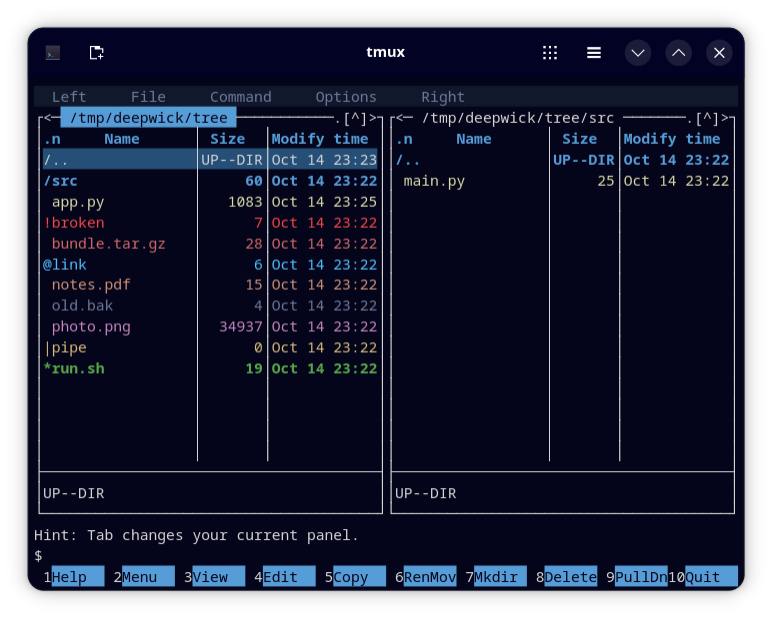

# Deepwick for Midnight Commander

Deepwick colors for [Midnight Commander](https://midnight-commander.org).

> Deepwick is an unofficial theme derived from
> [Polywick Blue](https://vscode.polywickstudio.net) by Polywick Studio (MIT).
> Not affiliated with Polywick Studio.



## Install

```sh
mkdir -p ~/.local/share/mc/skins
cp deepwick.ini deepwick16.ini ~/.local/share/mc/skins/
```

## Activate

Pick **Options → Appearance → Skin → Deepwick**, or set it in
`~/.config/mc/ini`:

```ini
[Midnight-Commander]
skin=deepwick
```

You can also run `MC_SKIN=deepwick mc`.

`deepwick` is the 24-bit skin. It needs `COLORTERM=truecolor` (most modern
terminals set it) and an mc built with S-Lang (Fedora, Debian and Ubuntu
packages are). Otherwise mc shows "Unable to use 'deepwick' skin with true
colors support" and falls back to its default skin. In that case use
`deepwick16`, which uses the 16 ANSI slots and looks right with a Deepwick
terminal theme ([Ptyxis](https://github.com/deepwick/ptyxis),
[Konsole](https://github.com/deepwick/konsole),
[Alacritty](https://github.com/deepwick/alacritty),
[Ghostty](https://github.com/deepwick/ghostty)).

## Notes

- File colors follow the Deepwick file-listing roles: directories bold Blue,
  executables bold Green, symlinks Cyan, broken links Red, devices and FIFOs
  Gold, archives Rose, media and images Magenta, documents Orange, source
  Yellow, temp files Muted. mc colors the whole row, not just the name.
- Dialogs, menus and the status bar sit on Surface; the cursor row is on
  Selection; marked files are bold Yellow.
- The internal editor's syntax colors come from mc's syntax files, not the
  skin, so they are not themed.
- In `deepwick16`, Gold becomes yellow and Cyan becomes bright cyan, because
  they have no ANSI slot.

Tested with GNU Midnight Commander 4.8.33.

## License

MIT. See [LICENSE](LICENSE).
